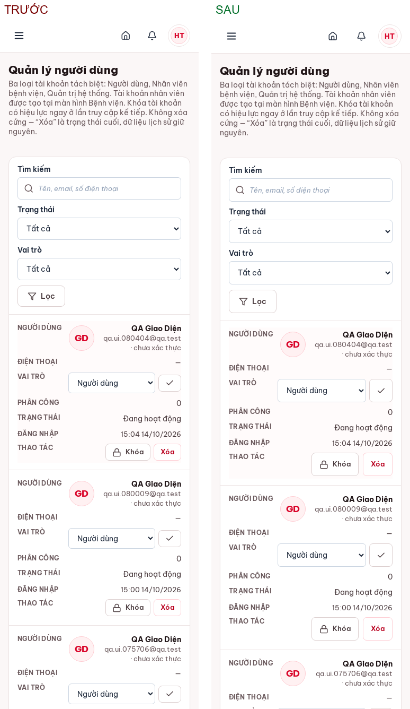
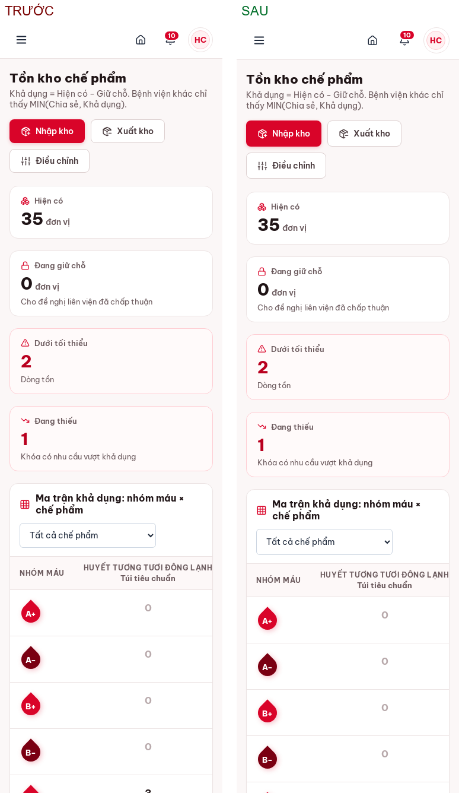
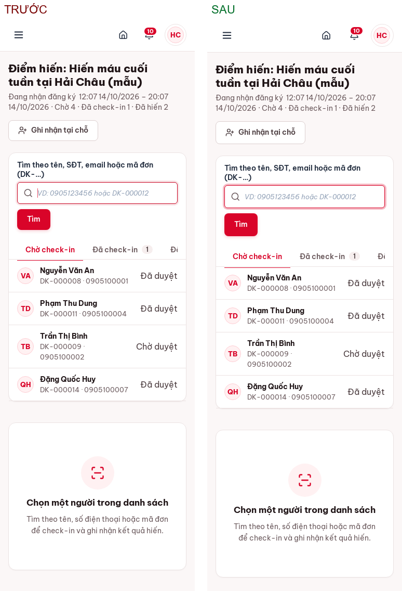
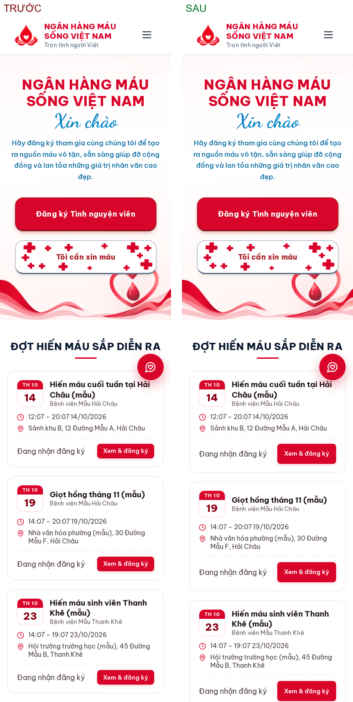
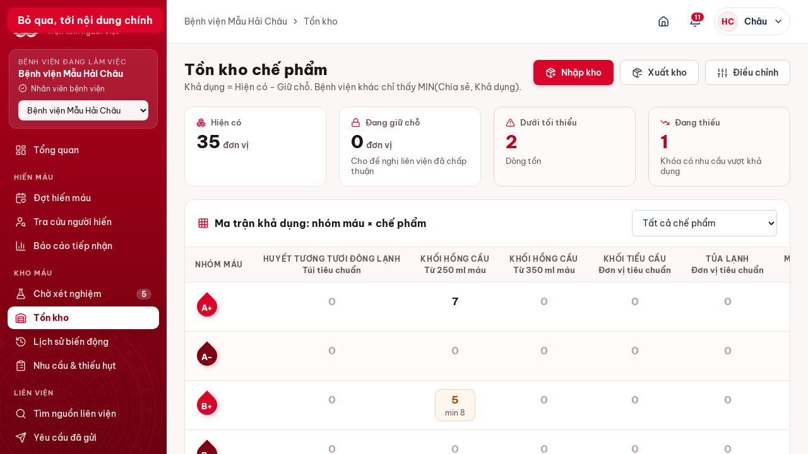
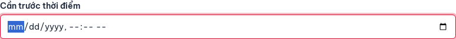
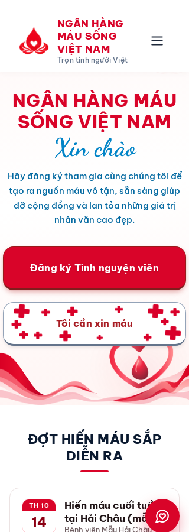
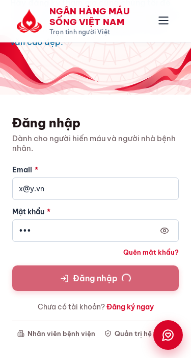

# 07 · Kiểm tra giao diện & trải nghiệm — trước / sau

**Ngày:** 14/10/2026 · **Môi trường:** QA cô lập `127.0.0.1:8091` (dữ liệu giả) · **Phạm vi:** 30 trang × 4 vai trò (khách, người dùng, bệnh viện, quản trị) × 2 khung nhìn (1440×900, 375×812), cộng các bề rộng 320/375/768/1024/1440 px.

## 1. Nguồn tiêu chí (4 repository)

| Repository | Dùng vào việc gì |
|---|---|
| **vercel-labs/agent-skills** — `web-design-guidelines` | Skill này tải bộ quy tắc từ `vercel-labs/web-interface-guidelines/command.md`. Đã rà mã nguồn theo các mục Accessibility, Focus States, Forms, Animation, Touch & Interaction, Hover, Anti-patterns |
| **nextlevelbuilder/ui-ux-pro-max-skill** | Ngưỡng định lượng: vùng bấm ≥ 44×44 px, khoảng cách ≥ 8 px, tương phản ≥ 4.5:1, có phản hồi khi đang xử lý, kiểm tra 375/768/1024/1440 px. Thứ tự ưu tiên: Accessibility → Touch → Layout → Forms/Feedback |
| **dequelabs/axe-core-npm** | `@axe-core/playwright` 4.10.1, `AxeBuilder.withTags(['wcag2a','wcag2aa','wcag21aa','wcag22aa'])`. Bộ tag này gồm cả quy tắc `target-size` (24 px) của WCAG 2.2 |
| **microsoft/playwright-mcp** | Áp dụng cách tiếp cận của nó: điều khiển qua cây trợ năng (role, name, nhãn) thay vì tọa độ pixel, và thu thập console/network. Script dùng thư viện Playwright 1.48 trực tiếp để có thể chạy lại và đưa vào CI. Muốn dùng MCP tương tác trong Claude Code thì chạy `claude mcp add playwright npx @playwright/mcp@latest`, sau đó khởi động lại phiên |

Script đo: [`playwright/ux_audit.js`](../playwright/ux_audit.js) (đo tự động) và [`playwright/ui_flows.py`](../playwright/ui_flows.py) (11 luồng thao tác thật).

## 2. Kết quả đo trước / sau (cùng script, cùng 60 lượt trang)

| Chỉ số | Trước | Sau | Ghi chú |
|---|---:|---:|---|
| Vi phạm axe WCAG 2.2 AA (số phần tử) | **24** | **0** | |
| Phần tử nhận focus nhưng không thấy chỉ báo (Tab 30 bước/trang) | **2** | **0** | |
| Phần tử focus bị header dính che | 0 | 0 | |
| Nút không đổi gì khi hover | 0 | 0 | |
| Trang tràn ngang ở 320 px | **1** | **0** | |
| Trang có skip link | **0 / 60** | **60 / 60** | |
| Vùng bấm < 44 px trên mobile | **455** | **62** (32 nếu chỉ tính phần tử trên màn hình) | Phần còn lại: link chữ trong breadcrumb và tiêu đề thẻ, nút zoom và ghim của Leaflet |
| Vùng bấm < 24 px (đo thô) | 128 | 118 | axe `target-size` đạt ở cả hai lần, vì các mục này đủ khoảng cách theo ngoại lệ của WCAG 2.5.8 (link footer, breadcrumb) → **đề xuất**, không phải lỗi |
| Luồng thao tác giao diện (Playwright) | 11/11 | 11/11 | |
| Trợ năng trong luồng (axe) | 0 | 0 | |
| Hiển thị 40 trang × 4 vai trò × 2 khung nhìn | 80/80 | 80/80 | |
| Test Django | 126/126 | 126/126 | Business logic không đổi |

Số liệu gốc: `evidence/runs/ux-before/ux_report.json`, `evidence/runs/ux-after/ux_report.json`, `evidence/runs/ux-compare.json`.

## 3. Lỗi đã xác nhận → đã sửa

| # | Vấn đề | Tiêu chí | Bằng chứng trước | Sửa | Kiểm lại |
|---|---|---|---|---|---|
| L1 | 12 nút "Sửa" ở `/danh-muc/` chỉ có biểu tượng bút chì, không có tên | axe `button-name` (critical), WCAG 4.1.2 | axe: 12 phần tử × 2 khung nhìn | Thêm `aria-label` + `title` riêng cho từng chế phẩm/quy cách | axe 0 |
| L2 | Nút "Kết nối đợt hiến" (chỉ có biểu tượng) ở chi tiết yêu cầu cần máu không có tên | web-interface-guidelines: icon-only cần `aria-label` | Rà template | Thêm `aria-label` + `title`. Đồng thời thêm `aria-label` cụ thể cho 3 nút chỉ có `title` (tồn kho, người dùng) | — |
| L3 | Ô ngày/giờ (ngày sinh, "Cần trước thời điểm") không hiện vòng focus khi Tab | WCAG 2.4.7 | Tab audit: `input[type=date]`, `input[type=datetime-local]` không có outline/box-shadow. Chrome không gán `:focus-visible` khi focus nằm ở ô con, còn `site.css` tắt outline | Thêm `:focus-within` + `var(--focus-ring)` cho mọi ô nhập | box-shadow `0 0 0 3px rgba(217,4,41,.28)` — [ảnh](img/after_date_focus.png) |
| L4 | Trang chủ tràn ngang 16 px ở 320 px | WCAG 1.4.10 Reflow | `.campaign-list` dùng `minmax(320px,1fr)`; sau đó chân thẻ đẩy nút ra ngoài 5 px; toast `min-width: 320px` | `minmax(min(100%,320px),1fr)`, chân thẻ được xuống dòng, toast giới hạn theo `100vw` | overflow = 0 — [ảnh](img/after_home_320.png) |
| L5 | Không có skip link. Workspace có khoảng 20 link ở thanh bên trước nội dung | WCAG 2.4.1, web-interface-guidelines | 0/60 trang | Link "Bỏ qua, tới nội dung chính" ở `base.html` (chỉ hiện khi Tab), `<main id="noi-dung" tabindex="-1">` | Tab → Enter → Tab tiếp theo nằm trong `<main>` — [ảnh](img/after_skip_link_focus.png) |

## 4. Đề xuất cải tiến

### Đã làm (tác động lớn, rủi ro thấp, dùng lại component có sẵn)

| # | Vấn đề | Nguồn | Sửa |
|---|---|---|---|
| D1 | Trên mobile, nút `.btn.sm` chỉ cao 32 px, nút biểu tượng 40 px, ô nhập 42 px, nút ẩn/hiện mật khẩu 34 px, tab 36 px, ô nhập trong bảng 34–39 px | ui-ux-pro-max: 44×44 | `@media (pointer: coarse), (max-width: 900px)`: `.btn`, `.btn.sm`, nút biểu tượng, ô nhập, tab ≥ 44 px. Desktop giữ nguyên mật độ. Số vùng bấm < 44 px trên mobile: 455 → 62 — [ảnh quản trị](img/cmp_mobile_admin_users.png), [ảnh kho](img/cmp_mobile_hospital_stock.png) |
| D2 | `transition: all` (biến `--transition` dùng ở 13 chỗ, cộng 2 nút ở trang chủ) | web-interface-guidelines (anti-pattern) | Liệt kê rõ từng thuộc tính: color, background-color, border-color, box-shadow, transform, opacity |
| D3 | Chưa có `touch-action: manipulation` / `-webkit-tap-highlight-color` | web-interface-guidelines | Đã thêm cho a, button, input, label |
| D4 | Vòng focus của ô nhập trong `site.css` quá nhạt (độ đậm 0.1) | ui-ux-pro-max: focus rõ ràng | Dùng chung `--focus-ring` của `ui.css` |

### Chưa làm (cần quyết định thiết kế hoặc tác động thấp)

| # | Vấn đề | Lý do để lại |
|---|---|---|
| E1 | Hàng chờ xét nghiệm và danh mục: **mỗi dòng có một nút primary** (5–7 nút primary trên một màn hình) | Màn hình hàng chờ có một thao tác chính lặp lại theo từng dòng nên vẫn chấp nhận được. Nếu muốn đúng nguyên tắc "1 primary mỗi màn hình" thì đổi nút trong dòng sang `secondary` |
| E2 | Trang chủ có 3 nút "Xem & đăng ký" màu primary trong 3 thẻ | Mỗi thẻ đúng 1 primary, không vi phạm |
| E3 | Mobile: thanh tab ở trang điểm hiến bị cắt ở cạnh phải, không có dấu hiệu cuộn ngang được | Nên thêm hiệu ứng mờ dần ở mép phải hoặc cho tab xuống dòng |
| E4 | Mobile: sau khi chọn người ở điểm hiến, khung check-in nằm dưới danh sách, phải tự cuộn | Đề xuất tự cuộn tới khung khi có `?reg=` |
| E5 | Link chữ trong breadcrumb, tiêu đề thẻ, footer nhỏ hơn 24 px chiều cao | Đạt WCAG theo ngoại lệ khoảng cách. Trên mobile đã tăng padding cho breadcrumb |
| E6 | Nút zoom và ghim của Leaflet nhỏ hơn 44 px | Component của thư viện bên thứ ba |
| E7 | Sau khi ghi nhận lượt hiến, thông báo nói "đã vào hàng Chờ xét nghiệm" nhưng không có link tới đó | Thêm link trong thông báo sẽ bớt 1 lần điều hướng |

### Đã kiểm tra: đạt, không cần sửa

- **Hover:** mọi nút đổi màu, bóng hoặc vị trí khi rê chuột (0 nút không phản hồi).
- **Disabled:** độ mờ 0.6 và `cursor: not-allowed` ([ui.css](../../backend/static/css/ui.css)).
- **Loading:** mọi form POST khóa nút ngay khi gửi, có spinner (`.is-loading::after`, animation `spin`), chống bấm đúp. Đo trên trang đăng nhập và quên mật khẩu: `disabled: true, is-loading: true, animation: spin` — [ảnh](img/after_loading_state.png). Lần đo đầu báo "không có" là do trang đã chuyển đi trước khi đo; đã đo lại bằng cách chặn việc gửi form.
- **Phản hồi sau thao tác:** 11 luồng đều có thông báo (toast) rõ ràng. Lỗi nghiệp vụ hiện đúng thông điệp, ví dụ "Chỉ còn N đơn vị khả dụng", "Thời gian kết thúc phải sau…". Toast có `aria-live="polite"`.
- **`prefers-reduced-motion`:** đã có ở `ui.css`, áp dụng cho mọi phần tử (`*`).
- **Heading:** mỗi trang đúng 1 `<h1>`.
- **Icon:** dùng SVG Lucide thống nhất, không dùng emoji. Biểu tượng trang trí có `aria-hidden`.
- **Bàn phím:** đăng nhập chỉ bằng Tab và Enter thành công. Hộp thoại xác nhận dùng `<dialog>` gốc (Esc để đóng, focus nằm trong hộp thoại).

## 5. Số bước của các tác vụ chính (đo trên luồng Playwright thật)

| Tác vụ | Vai trò | Số thao tác | Nhận xét |
|---|---|---|---|
| Đăng ký hiến một đợt | Người dùng | 3 click (Đợt hiến → chọn đợt → Đăng ký) | Tốt |
| Gửi yêu cầu cần máu | Người dùng | 1 click từ trang chủ + 5 trường bắt buộc + gửi | Tốt; form trống bị chặn và báo lỗi ngay tại trường |
| Check-in → ghi nhận lượt hiến | Bệnh viện | 3 click + 1 trường (thể tích) | Tốt; hiện xác nhận tóm tắt trước khi ghi |
| Ghi nhận → nhập kho sau xét nghiệm | Bệnh viện | 3 click + 2 trường (kết quả, nhóm máu) + điều hướng sang "Chờ xét nghiệm" | Xem E7 |
| Xuất kho | Bệnh viện | 1 trang, 3 trường + xác nhận | Tốt; xuất vượt tồn bị chặn kèm số khả dụng |
| Chấp thuận đề nghị liên viện | Bệnh viện cấp | 2 click (danh sách → chi tiết → Chấp thuận, số lượng điền sẵn) | Tốt |
| Đổi cấu hình hệ thống | Quản trị | 1 trường + 1 nút trên cùng dòng | Tốt |

## 6. Ảnh trước / sau

| | |
|---|---|
| Quản trị · người dùng (mobile 375) |  |
| Bệnh viện · tồn kho (mobile 375) |  |
| Bệnh viện · điểm hiến (mobile 375) |  |
| Trang chủ (mobile 375) |  |
| Sau — skip link khi Tab |  |
| Sau — vòng focus ô ngày giờ |  |
| Sau — trang chủ 320 px |  |
| Trạng thái loading khi gửi form |  |

Toàn bộ 120 ảnh chụp từng trang: `evidence/runs/ux-before/`, `evidence/runs/ux-after/`.

## 7. Danh sách file thay đổi trong đợt UI/UX này

| File | Thay đổi |
|---|---|
| `backend/static/css/ui.css` | Skip link; vòng focus cho ô nhập (`:focus-within`); reflow 320 px (lưới thẻ, toast, chân thẻ); `touch-action`, tap highlight; vùng bấm 44 px trên mobile |
| `backend/static/css/site.css` | `--transition` và 2 nút trang chủ: bỏ `transition: all`, liệt kê thuộc tính |
| `backend/templates/base.html` | Thêm skip link |
| `backend/templates/layouts/public.html`, `layouts/workspace.html`, `accounts/auth_base.html` | `<main id="noi-dung" tabindex="-1">` làm đích cho skip link |
| `backend/templates/shared/catalog.html` | `aria-label` cho nút sửa chế phẩm/quy cách |
| `backend/templates/hospital/patient_request_detail.html` | `aria-label` cho nút kết nối đợt hiến |
| `backend/templates/hospital/stock.html`, `admin/users.html` | `aria-label` cụ thể cho nút lưu / lịch sử chỉ có biểu tượng |
| `qa-audit/playwright/ux_audit.js` *(mới)* | Script đo UX/UI: axe-core, vùng bấm, focus, hover, phân cấp nút, reflow |

Không thay đổi Python, model, service hay view. Business logic giữ nguyên, 126/126 test Django đạt.

Các thay đổi giao diện ở vòng trước (CSP, chuyển script inline ra `maps.js`, 5 lỗi axe ban đầu) đã ghi trong `02_TEST_CASES.md` mục I.
